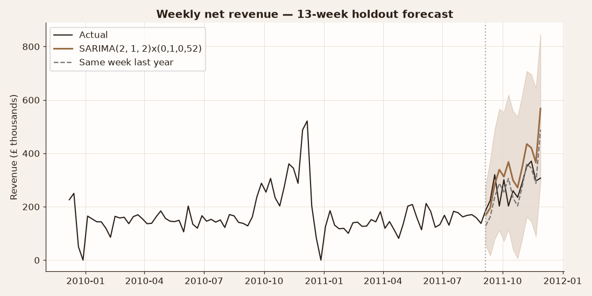
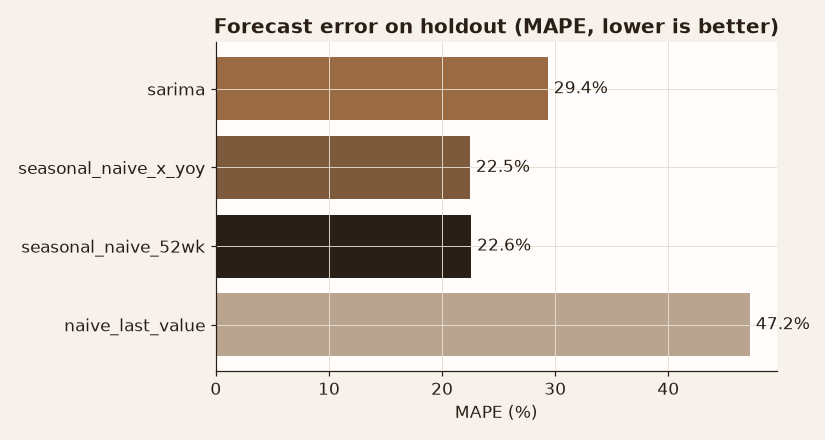
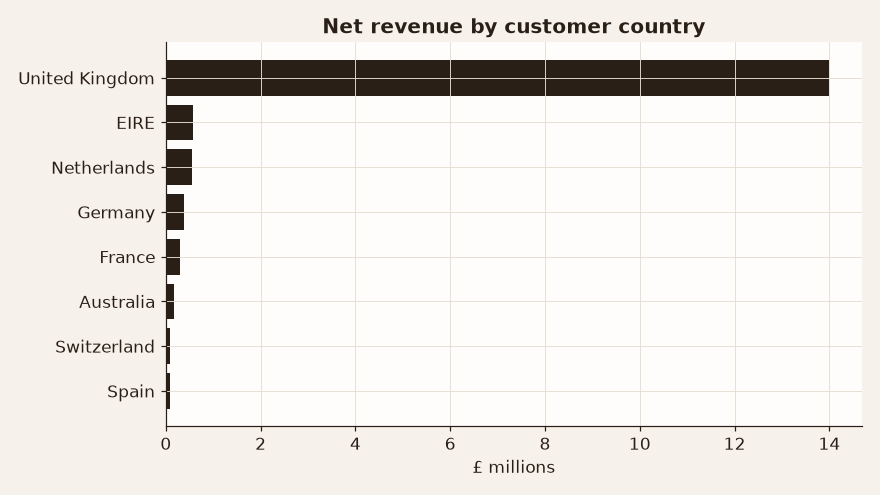

# Retail Sales Warehouse & Weekly Revenue Forecast

**Business question:** An online wholesaler runs on raw transaction exports. Can we turn them into a clean star-schema warehouse that answers standard questions (revenue, cancellations, markets, customer cohorts), and forecast next quarter's weekly revenue well enough to plan stock and staffing?

## Data
- **Online Retail II:** UCI Machine Learning Repository, [dataset 502](https://archive.ics.uci.edu/dataset/502/online+retail+ii). License: **CC BY 4.0**.
- 1,067,371 invoice lines, Dec 2009 to Dec 2011.
- Run `data/get_data.sh` to download it.

## Approach
1. **SQL (DuckDB)**
   - `sql/01_schema.sql` builds a staging table, then `dim_product` (most frequent label per stock code via `arg_max`), `dim_customer`, `dim_date` and `fact_sales` (cancellations flagged, not deleted).
   - `sql/02_analysis.sql` answers:
     - Gross vs cancelled revenue by year (`FILTER` aggregates).
     - A country Pareto with a running share (`SUM() OVER`).
     - First-purchase customer cohorts.
     - The weekly revenue series with a 4-week rolling average.
2. **Python** (`python/analysis.py`)
   - Runs both SQL files into a persistent `warehouse.duckdb`.
   - ADF stationarity tests.
   - Compares four forecasts on a **13-week holdout** (Sep 5 – Nov 28, 2011): last value, same week last year, same week last year × trailing YoY growth, and SARIMA (orders chosen by AIC, with a 52-week seasonal difference).
3. **R** (`r/analysis.R`): `forecast::auto.arima` vs `snaive` on the same holdout design.

## Key results
| Metric | Value |
|---|---|
| Warehouse | fact_sales **1,055,162** rows; 4,950 products; 5,942 customers; 604 trading days |
| Cancellation rate | 2.4% (2009), 2.5% (2010), **4.9% (2011)**. It nearly doubled |
| Market concentration | UK = **83.7%** of net revenue. Top 5 countries = 94.4% |
| Cohort value | Customers acquired in 2010-Q1: £2,767 each, vs. £1,227 for 2011-Q1 (newer cohorts have had less time to buy) |
| Same week last year (holdout) | RMSE **£73,258**, MAPE **22.6%** |
| Same week last year × YoY growth (1.078) | RMSE £82,064, MAPE 22.5% |
| SARIMA(2,1,2)×(0,1,0)52 | RMSE £102,541, MAPE 29.4% |
| Last-value naive | RMSE £146,800, MAPE 47.2% |
| R auto.arima ARIMA(2,0,0)(0,1,0)52 vs snaive | RMSE £67,082 vs £67,177 (MAPE 19.9% vs 20.0%) |

**Takeaway:** with only two years of history, the yearly pattern dominates. A "same week last year" forecast beat a tuned SARIMA in Python and tied auto.arima in R. The honest recommendation is to plan from last year's curve and revisit model-based forecasting once a third year of data exists. The doubling cancellation rate in 2011 is the warehouse's most actionable finding.

*Note:* the 2009-Q4 cohort includes all customers already active when the data starts, so its per-customer value is inflated.

## Figures




## How to run
```bash
pip install -r requirements.txt
bash data/get_data.sh
python python/analysis.py     # builds data/warehouse.duckdb, runs SQL + forecasts
Rscript r/analysis.R          # needs dplyr, forecast
```
